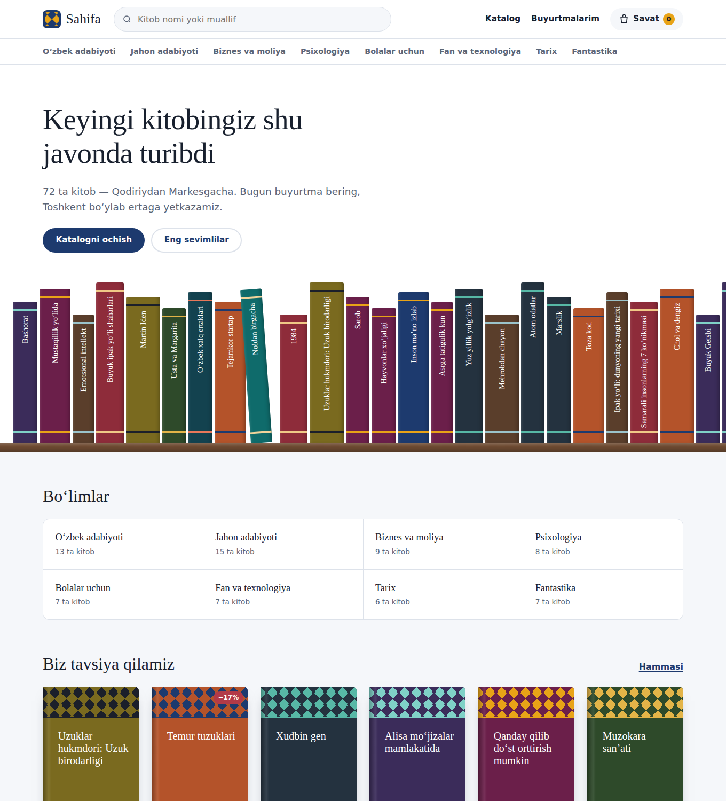
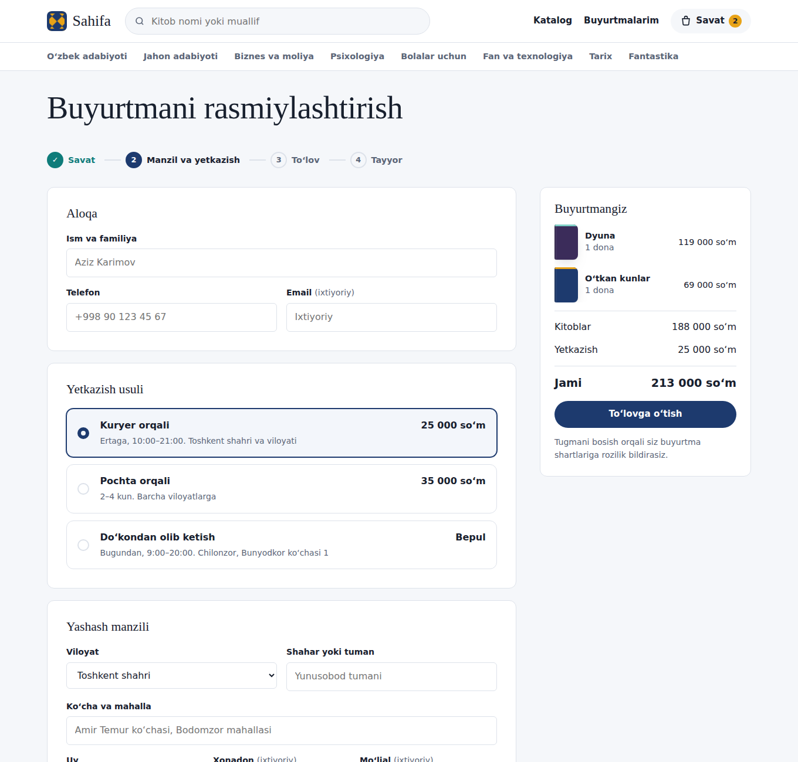
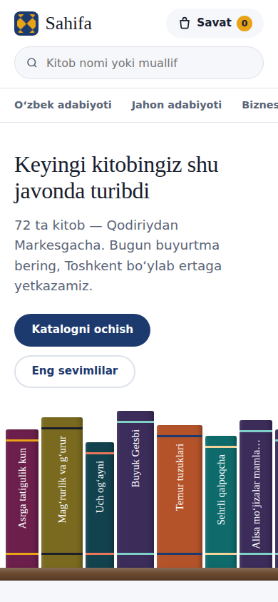

# Sahifa — onlayn kitob do‘koni

Django’da yozilgan onlayn kitob do‘koni: katalog, savat, yashash manzili bilan buyurtma,
O‘zbekiston bo‘ylab yetkazib berish va karta orqali onlayn to‘lov.



## Imkoniyatlar

- **Katalog** — 8 bo‘lim va 72 ta kitob; nom yoki muallif bo‘yicha qidiruv, bo‘lim, narx, til va ombor filtrlari, saralash, sahifalash.
- **Kitob sahifasi** — narx va chegirma, ombordagi soni, yetkazish narxlari, shu bo‘limdagi o‘xshash kitoblar.
- **Savat** — sessiyada saqlanadi, ro‘yxatdan o‘tish shart emas; bepul yetkazishgacha qolgan summa ko‘rinadi.
- **Buyurtma** — mijoz viloyat, shahar/tuman, ko‘cha, uy, xonadon va mo‘ljalni kiritadi; telefon `+998` formatida tekshiriladi.
- **Yetkazib berish** — kuryer (Toshkent, ertaga; 300 000 so‘mdan bepul), pochta (viloyatlarga, 2–4 kun), do‘kondan olib ketish.
- **Onlayn to‘lov** — karta orqali (demo shlyuz) yoki qabul qilganda naqd pul.
- **Buyurtma holati** — qabul qilindi, to‘landi, yig‘ilmoqda, yo‘lda, yetkazildi; “Buyurtmalarim” sahifasi.
- **Admin panel** — kitoblar, narx va ombor sonini ro‘yxatning o‘zida tahrirlash, buyurtma holatini o‘zgartirish.
- Kitob muqovalari CSS bilan chiziladi (koshin naqshi), shuning uchun rasm yuklash shart emas.

| Buyurtma rasmiylashtirish | Mobil |
|---|---|
|  |  |

## Ishga tushirish

```bash
git clone https://github.com/<foydalanuvchi>/sahifa.git
cd sahifa
python3 -m venv .venv
source .venv/bin/activate          # Windows: .venv\Scripts\activate
pip install -r requirements.txt
python manage.py migrate
python manage.py seed_books         # 72 ta kitob qo‘shadi
python manage.py createsuperuser    # admin panel uchun
python manage.py runserver
```

Sayt: http://127.0.0.1:8000 · Admin: http://127.0.0.1:8000/admin

## Onlayn to‘lovni sinash

To‘lov hozircha **demo** rejimda ishlaydi, haqiqiy pul yechilmaydi:

| Karta | Natija |
|---|---|
| `4242 4242 4242 4242` | To‘lov muvaffaqiyatli |
| `4000 0000 0000 0002` | Bank rad etadi |

Muddat sifatida kelajakdagi istalgan oyni kiriting, masalan `12/29`.

Haqiqiy to‘lovga o‘tish uchun Payme yoki Click’da merchant sifatida ro‘yxatdan o‘tib,
`shop/payments.py` ga yangi shlyuz klassi qo‘shiladi va `PAYMENT_PROVIDER` sozlamasi o‘zgartiriladi.
View’larni o‘zgartirish shart emas.

## Testlar

```bash
python manage.py test shop
```

## Tuzilma

```
PROJECT/            sozlamalar va asosiy URL'lar
shop/
  models.py         Category, Book, Order, OrderItem
  cart.py           sessiyadagi savat
  delivery.py       yetkazish narxlari va muddatlari
  forms.py          buyurtma va karta formalari
  payments.py       to‘lov shlyuzi (demo)
  views.py, urls.py
  templates/shop/   shablonlar
  static/shop/      CSS va JS
  management/commands/seed_books.py
app_main/           o‘quv blogi (/blog/)
```

## Ishlab chiqarishga (production) chiqarishdan oldin

`DJANGO_SECRET_KEY`, `DJANGO_DEBUG=0` va `DJANGO_ALLOWED_HOSTS` muhit o‘zgaruvchilarini o‘rnating.
Repozitoriydagi kalit faqat lokal ishlab chiqish uchun.
